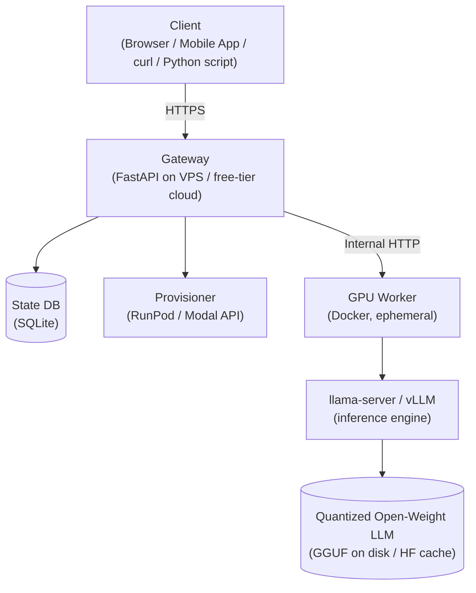

# On-Demand Personal LLM Inference Platform

### Project Overview & Technical Specification

*Personal Project · AI Engineering · 2025*

---

## Table of Contents

1. [Project Summary](#1-project-summary)
2. [Problem Statement & Motivation](#2-problem-statement--motivation)
3. [How It Works](#3-how-it-works)
   - 3.1 [The Gateway (Always On, Always Cheap)](#31-the-gateway-always-on-always-cheap)
   - 3.2 [The GPU Worker (Ephemeral)](#32-the-gpu-worker-ephemeral)
   - 3.3 [Full Request Lifecycle](#33-full-request-lifecycle)
4. [Architecture](#4-architecture)
   - 4.1 [Component Diagram](#41-component-diagram)
   - 4.2 [Gateway Internal Architecture](#42-gateway-internal-architecture)
   - 4.3 [Worker Internal Architecture](#43-worker-internal-architecture)
5. [Technology Stack](#5-technology-stack)
   - 5.1 [Prototype Stack (Phases 1–3)](#51-prototype-stack-phases-13)
   - 5.2 [Production Stack (Phases 4–6)](#52-production-stack-phases-46)
6. [Cold Start: The Core Engineering Problem](#6-cold-start-the-core-engineering-problem)
   - 6.1 [Handling Cold Starts Gracefully](#61-handling-cold-starts-gracefully)
   - 6.2 [Minimizing Cold Start Time](#62-minimizing-cold-start-time)
   - 6.3 [Choosing an Idle Timeout](#63-choosing-an-idle-timeout)
7. [Conversation & Context Management](#7-conversation--context-management)
   - 7.1 [The Naive Approach (Don't Do This)](#71-the-naive-approach-dont-do-this)
   - 7.2 [Sliding Window Strategy (Recommended)](#72-sliding-window-strategy-recommended)
   - 7.3 [Summarisation Strategy (Optional, Phase 6+)](#73-summarisation-strategy-optional-phase-6)
8. [Development Roadmap](#8-development-roadmap)
9. [Known Challenges & Solutions](#9-known-challenges--solutions)
10. [Success Metrics](#10-success-metrics)
11. [Learning Outcomes](#11-learning-outcomes)
12. [Future Enhancements](#12-future-enhancements)
13. [Appendix: Recommended Resources](#appendix-recommended-resources)

---

## 1. Project Summary

This project builds a serverless, on-demand inference API for open-weight large language models. Instead of running a GPU server full-time (expensive) or relying on commercial APIs like OpenAI (costly and private), this system provisions GPU compute only when a request arrives, routes it through a stable API gateway, returns the response, and then shuts the GPU worker back down after a period of inactivity — costing nothing while idle.

The system uses a permanent, always-on lightweight gateway (running cheaply on a small VPS or free-tier cloud service) as the stable face of the API. This gateway is responsible for managing model lifecycle and proxying traffic to the GPU worker — which is ephemeral and only lives long enough to handle demand.

> **Scope note:** This is a **single-user** personal system — just you. There is no multi-tenant design, no per-user accounts, and no concurrency control for competing requests, since only one person is ever sending prompts at a time. There is also deliberately **no application-level authentication** (see [Section 9](#9-known-challenges--solutions)) — the only light recommendation is to avoid making the gateway's URL public (e.g. keep it behind a tunnel like ngrok/Tailscale, or a firewall allow-list) rather than exposing it to the open internet by IP.

---

## 2. Problem Statement & Motivation

Running large language models presents a resource trilemma. Each available option has a fundamental drawback:

**Three Bad Options Without This Project**

- **Local GPU** — Requires expensive hardware ($1,000–$3,000+ for a capable GPU). Consumes power 24/7 even when idle. Not accessible remotely.
- **Commercial APIs (OpenAI, Anthropic)** — Costs money per token. Your data leaves your machine. No control over the model or its behaviour.
- **Rented Cloud GPU** (e.g. Lambda Labs, RunPod) — Powerful, but billed by the hour even when your model is just sitting there waiting. A $0.50/hr GPU left on for a month costs ~$360.

The insight behind this project is simple: a GPU is only needed for a few seconds at a time, during active inference. The rest of the time — which is most of the time for a personal user — the GPU should not exist. This project builds the infrastructure that makes that on-demand lifecycle automatic and transparent.

The result is an always-available API endpoint (running cheaply on a small server) that wakes up GPU compute on demand, runs your model, and tears it back down — costing near-zero while idle.

---

## 3. How It Works

The system has two distinct tiers that serve very different roles.

### 3.1 The Gateway (Always On, Always Cheap)

The gateway is a lightweight FastAPI service running on a small, cheap server — a $5/month VPS, a free-tier cloud instance, or even a spare Raspberry Pi. It is the permanent, public-facing part of the system. Its job is:

- Accept incoming HTTP requests from your apps, scripts, or browser
- Check whether the GPU worker is currently alive and ready
- If not, send a provisioning command to spin up a GPU worker
- Queue incoming requests while the worker is starting up
- Forward requests to the worker once it's ready and stream back responses
- Reset an idle timer after each response; shut down the worker when it expires

The gateway never runs the model itself. It is purely a router, state manager, and lifecycle controller. Because it does no heavy computation, it can run on the cheapest hardware available.

### 3.2 The GPU Worker (Ephemeral)

The GPU worker is a Docker container that is launched on a cloud GPU provider (RunPod, Modal, or Vast.ai) only when needed. It contains:

- The model server — llama.cpp's built-in HTTP server (`llama-server`) for the prototype, vLLM for production
- The quantized model weights, downloaded from Hugging Face on first run and cached for subsequent starts
- A health endpoint the gateway polls to know when the worker is ready

Once the worker starts and reports healthy, the gateway begins forwarding requests to it. After a configurable idle period with no requests (see [6.3 Choosing an Idle Timeout](#63-choosing-an-idle-timeout)), the gateway calls the provider's API to terminate the worker. At that point, the GPU cost stops.

### 3.3 Full Request Lifecycle

Here is the complete journey of a single request through the system:

1. User sends a prompt to the gateway's `/chat` endpoint
2. Gateway checks worker status: `IDLE`, `STARTING`, or `READY`
3. If `IDLE`: gateway calls RunPod/Modal API to launch a new worker; returns `202 Accepted` with a job ID; status becomes `STARTING`
4. If `STARTING`: gateway queues the request and holds the connection open with SSE (Server-Sent Events) or polling
5. Worker comes online (typically 30–90 seconds for a quantized 7B model); status becomes `READY`
6. Gateway forwards the prompt and conversation history to the worker
7. Worker runs inference; streams tokens back to the gateway
8. Gateway streams tokens to the client in real time
9. After response completes, gateway stores the turn in the SQLite/PostgreSQL database
10. Idle timer resets; if no further requests arrive within the timeout, gateway calls the provider API to terminate the worker

One important design decision: the gateway must explicitly handle the `STARTING` state without dropping the request. A naive implementation returns an error when the worker is cold, forcing the client to retry. The correct design queues the request transparently so the user's experience is simply a longer wait for the first message, not an error.

---

## 4. Architecture

### 4.1 Component Diagram

Read downward as the request flow; read upward for responses.

### 4.2 Gateway Internal Architecture

The gateway is itself a small but well-structured FastAPI application. Its key internal modules are:

| Module | Responsibility |
|---|---|
| `state.py` | In-memory + DB-backed worker state machine: `IDLE → STARTING → READY → IDLE` |
| `provisioner.py` | Abstracts the GPU provider API (RunPod, Modal, Vast.ai). Swapping providers means swapping this module only |
| `proxy.py` | Forwards requests to the worker, handles streaming via SSE or chunked HTTP |
| `queue.py` | Holds requests that arrive while the worker is `STARTING`; releases them when `READY` |
| `storage.py` | Reads and writes conversation history to the database |
| `idle_timer.py` | Background asyncio task that counts down and fires the teardown when idle |

### 4.3 Worker Internal Architecture

The GPU worker is intentionally minimal. It is a Docker image containing:

- llama.cpp compiled with CUDA support (for prototype) or vLLM (for production)
- A startup script that downloads and caches model weights from Hugging Face on first run
- The model server listening on a local port
- A `/health` endpoint that returns `200 OK` once the model is loaded and ready

The worker has no knowledge of sessions, users, or history. All of that state lives in the gateway. The worker's only job is: receive a prompt and conversation context, generate tokens, stream them back.

---

## 5. Technology Stack

Technology choices are divided into prototype-phase (Phases 1–3) and production-phase (Phases 4–6). Start simple; graduate only when you hit a real limitation.

### 5.1 Prototype Stack (Phases 1–3)

| Component | Technology | Why This Choice |
|---|---|---|
| Gateway framework | FastAPI | Async-native Python web framework; built-in SSE support; OpenAPI docs generated automatically |
| Inference engine | llama.cpp / llama-server | Runs GGUF quantized models; works on CPU too (useful for testing without GPU); built-in HTTP server saves complexity |
| Database | SQLite | Zero-ops file-based database; Python stdlib access; trivially migrated to PostgreSQL via SQLAlchemy later |
| Tunnel (local dev) | ngrok | Exposes local server to the internet; free tier sufficient for personal use; lets you test the full request flow before cloud deployment |
| Model format | GGUF (Q4_K_M) | 4-bit quantized weights; Mistral 7B fits in ~4GB VRAM or RAM; loads in 5–15 seconds on modern hardware |
| Container | Docker | Reproducible worker environment; same image runs locally, on Kaggle, and on RunPod/Modal |
| GPU provider (dev) | Kaggle Notebooks | Free 30hrs/week GPU (T4 or P100); longer sessions than Colab; supports Docker-style environments; no programmatic provisioning but fine for prototype |

### 5.2 Production Stack (Phases 4–6)

| Component | Technology | Why This Choice |
|---|---|---|
| GPU provider | RunPod Serverless or Modal | Both have REST APIs for programmatic provisioning; $0 idle cost; cold-start typically 30–90s for a quantized 7B |
| Inference engine | vLLM | Production-grade inference server with continuous batching; significantly higher throughput than llama.cpp; requires CUDA GPU with sufficient VRAM |
| Database | PostgreSQL | Graduate from SQLite when you need concurrent writes or remote database access; same SQLAlchemy ORM code |
| Cache | Redis | Introduce only if you need pub/sub for worker status events or response caching; not needed before Phase 5 |
| Observability | Prometheus + Grafana | Metrics export from FastAPI; dashboards for cold-start time, GPU cost per request, idle time |
| Gateway hosting | Fly.io or Railway | Free-tier hosting for the always-on gateway; both support Docker deployment; auto-restart on failure |

**What Is NOT In This Stack (and Why)**

- **Google Colab** — Cannot expose inbound connections (no public IP, no open ports). Cannot be provisioned via API. Sessions die after 90 minutes idle. Use Kaggle for GPU testing; use RunPod/Modal for programmatic provisioning.

---

## 6. Cold Start: The Core Engineering Problem

The cold start — the delay between a request arriving and the model being ready — is the central UX challenge of this architecture. On RunPod Serverless with a quantized Mistral 7B, expect 30–90 seconds from "launch worker" to "first token." This needs explicit design; it cannot be a user-facing error.

### 6.1 Handling Cold Starts Gracefully

The recommended pattern is a two-phase response:

1. Client sends request to gateway. Gateway detects worker is `IDLE`.
2. Gateway immediately returns `HTTP 202 Accepted` with a job ID and an estimated wait time.
3. Gateway fires provisioning API call to RunPod/Modal in the background.
4. Client either polls `GET /status/{job_id}` or maintains an SSE connection to receive a `worker_ready` event.
5. Once the worker reports healthy, gateway processes any queued requests.
6. Client receives a `ready` signal and the response streams in normally.

This design means the client always gets a response code immediately and is never left hanging on a connection that appears frozen. The cold start wait is explicit and visible, not an invisible timeout.

### 6.2 Minimizing Cold Start Time

- Use GGUF quantized models (Q4_K_M precision). Mistral 7B Q4_K_M is ~4.1GB and loads in 5–20 seconds on GPU; Q8 is higher quality but loads slower.
- Cache model weights on the worker's container volume (RunPod network volumes, Modal volumes). First cold start downloads from HuggingFace (~4GB); subsequent starts load from local disk.
- Keep the Docker image small and prebuilt. Download weights at image build time if the provider supports it, not at runtime.
- Pre-warm: on high-use periods, send a no-op "keepalive" request before the idle timer fires to extend the worker's life.

### 6.3 Choosing an Idle Timeout

The idle timeout is the single knob that controls the tradeoff between **cold-start frequency** and **idle GPU cost**. A shorter timeout tears the worker down sooner (cheaper, but you re-pay the cold-start wait more often); a longer timeout keeps the worker warm through natural pauses in conversation (fewer cold starts, but you're paying for GPU minutes nobody is using).

**Rule of thumb:** cost of staying idle an extra `N` minutes ≈ `N / 60 × GPU_$/hr`. At a typical RunPod rate of **$0.50/hr**, staying warm for an *extra* 20 minutes after your last message costs about **$0.17** — compare that against how annoying a 60–90 second cold start actually is for your own usage pattern.

| Idle Timeout | Cold-start frequency | Idle-cost impact | Best for |
|---|---|---|---|
| 2 minutes | High — any short pause between messages re-triggers a cold start | Lowest — GPU is almost never billed while unused | Infrequent, one-off questions spread throughout the day |
| **10 minutes (recommended default)** | Low-to-moderate — covers normal back-and-forth chat pauses | Small — a few extra idle cents per session | Typical personal chat usage; a reasonable starting point |
| 30+ minutes | Rare | Noticeable — you pay for GPU time between messages even when you've stepped away | Only if cold starts are unusually disruptive and a few dollars/month extra is acceptable |

Start with the 10-minute default, then tune it using your own logged usage data (see [Section 10, Success Metrics](#10-success-metrics)) — if your sessions naturally have gaps longer than 10 minutes between messages, nudge it up slightly; if your monthly spend is higher than expected, bring it down.

---

## 7. Conversation & Context Management

LLMs have a finite context window — the maximum number of tokens they can process in a single inference call. Mistral 7B has a 32K token context window; smaller models may have 4K–8K. This directly constrains how you inject conversation history into each request.

### 7.1 The Naive Approach (Don't Do This)

Loading all stored conversation history and injecting every turn into every prompt. This works for a few turns. After 20+ turns it either exceeds the context limit (causing errors or truncated responses) or inflates inference cost and latency with tokens that add no signal.

### 7.2 Sliding Window Strategy (Recommended)

The gateway maintains full conversation history in the database. For each inference call, it injects only the last N turns (e.g., 10 turns) into the prompt. Older turns exist in storage but are not sent to the model. This is simple to implement and adequate for most personal use cases.

### 7.3 Summarisation Strategy (Optional, Phase 6+)

For very long conversations, the gateway can periodically call the LLM to summarise older turns into a compressed "memory block." This block is stored in the database and injected at the top of each prompt, followed by recent turns. This preserves long-term context at the cost of one extra inference call.

---

## 8. Development Roadmap

The roadmap is structured so that each phase produces something functional and testable. Never advance to the next phase until the current one works end-to-end.

| Phase | What You Build | Outcome | Difficulty |
|---|---|---|---|
| **Phase 1** | Local inference: Run llama.cpp + llama-server locally. Download a GGUF model. Send prompts via curl. No gateway yet. | Understand inference basics; benchmark cold-start and token speed | Low |
| **Phase 2** | Expose via ngrok: Wrap llama-server behind a minimal FastAPI app. Expose publicly with ngrok. Since this is single-user with no app-level auth, restrict access via ngrok's basic-auth or IP allow-list instead. | Full remote access to your local model via a stable URL | Low–Med |
| **Phase 3** | Conversation memory: Add SQLite storage. Implement sliding-window context injection. Build a simple HTML/JS chat UI. | Persistent multi-turn conversations through a browser | Medium |
| **Phase 4** | Docker + Kaggle: Containerise the worker. Test running the Docker image on Kaggle GPU notebooks manually. | Reproducible, portable worker environment | Medium |
| **Phase 5** | Cloud provisioning: Migrate worker to RunPod Serverless or Modal. Build `provisioner.py` to call their APIs. Implement `STARTING` state and request queueing. | Automatic cold-start provisioning; near-zero idle cost | High |
| **Phase 6** | Idle shutdown + observability: Implement the idle timer. Add Prometheus metrics. Deploy gateway to Fly.io or Railway. Switch to PostgreSQL. | Production-ready personal inference platform with cost controls | High |
| **Phase 7 (Optional)** | vLLM upgrade + multi-model: Replace llama.cpp with vLLM. Add model routing (route different requests to different model sizes). | Higher throughput; multi-model support | High |

---

## 9. Known Challenges & Solutions

**Dynamic Worker URLs**
Each time a new worker is provisioned, it gets a different IP address and port. The gateway must query the provider API after launch to retrieve the worker's endpoint URL. The client always talks to the permanent gateway URL and never needs to know the worker's address. This is the core reason the gateway exists.

**Worker Health Polling**
After launching a worker, the gateway must poll the worker's `/health` endpoint until it returns `200 OK`. The model may take 30–90 seconds to load. The polling loop should back off (1s, 2s, 4s intervals) and enforce a maximum wait time (e.g., 5 minutes) after which the worker is declared failed and the provisioning is retried.

**Provider API Failures**
RunPod and Modal APIs can fail. Worker containers can crash mid-inference. The gateway must detect these failures (via timeouts, health check failures, or provider webhooks) and transparently reprovision. Conversations should not be lost; only in-flight requests may fail and should return a retryable `503` error.

**Streaming Across Two Hops**
The client expects tokens to stream in real time. The worker streams tokens to the gateway; the gateway must re-stream them to the client without buffering the entire response. FastAPI supports this natively via `StreamingResponse` with an async generator. This needs to be tested carefully — buffering anywhere in the chain breaks the streaming UX.

**No Application-Level Authentication (by design)**
This is a single-user system, so there's no API key, login, or per-user isolation layer — adding one would be pure overhead for a project with exactly one user. The only practical risk is the gateway's URL being discovered and hit by someone else, which would trigger GPU spend on your behalf. Mitigate this with network-level controls instead of app-level auth: keep the gateway behind a private tunnel (ngrok, Tailscale) or a firewall IP allow-list rather than a fully public DNS name, and keep an eye on the cost metrics in [Section 10](#10-success-metrics) to catch any unexpected spend early.

---

## 10. Success Metrics

Concrete, measurable targets. Evaluate at the end of Phase 6.

| Metric | Target | How to Measure |
|---|---|---|
| Cold-start time (P95) | < 90 seconds | Log gateway timestamp from `IDLE → READY`; sample 20 cold starts |
| First token latency (warm) | < 3 seconds | Time from request forward to first streamed token from worker |
| Idle GPU cost | $0.00/hr while idle | Verify worker termination via provider dashboard after each idle timeout |
| **Total monthly GPU spend** | **< $5–10/month** (set your own budget based on usage) | Sum of GPU-provider billing dashboard over a rolling 30 days |
| **Cost per inference request** | **Meaningfully lower than the commercial-API equivalent** (e.g. vs. GPT-4o-mini's $/1K-token rate) | `(total GPU spend ÷ number of requests served)` compared against the equivalent commercial API cost for the same prompts |
| API uptime (gateway) | > 99% over 30 days | Uptime monitoring via BetterUptime (free tier) |
| Context injection accuracy | Last N turns always present in prompt | Manual inspection of logs; automated test comparing injected context to stored history |
| Conversation persistence | Zero lost turns across restarts | Restart gateway; verify all prior history loads correctly |

---

## 11. Learning Outcomes

This project is deliberately designed as an engineering learning platform. Building it teaches a dense cluster of skills that are directly relevant to AI engineering and backend infrastructure roles.

**Core Skills Built**

- Containerisation: Docker
- Python backend: FastAPI async patterns, SSE streaming, middleware, dependency injection
- Databases: SQLite → PostgreSQL with SQLAlchemy ORM; data modelling for conversations
- Cloud provider APIs: REST API consumption for GPU provider provisioning; webhook handling
- LLM inference: GGUF quantization; llama.cpp configuration; context window management; prompt formatting
- Observability: Prometheus metrics; structured logging; async background tasks

**Skills Deliberately Deferred**

- Kubernetes — not applicable at this scale; learn after this project if pursuing platform engineering
- Celery / distributed task queues — asyncio handles single-worker queuing adequately
- Terraform / IaC — worthwhile eventually, but manual provisioning is fine for a personal project

---

## 12. Future Enhancements

Once Phase 6 is complete, the following extensions are natural next steps:

- **Multi-model routing** — Route requests to different model sizes based on task complexity (7B for quick questions, 70B for reasoning-heavy tasks)
- **RAG pipeline** — Add a vector database (Qdrant or Chroma) to enable retrieval-augmented generation over personal documents
- **Agent workflows** — Integrate tool-calling support so the LLM can search the web, run code, or read files as part of a response
- **Auto provider selection** — Compare live pricing across RunPod, Modal, and Vast.ai at provisioning time; pick the cheapest available GPU
- **Cost dashboard** — Track GPU spend per conversation and per day; set hard monthly caps
- **Fine-tuned model management** — Support swapping in LoRA adapters or full fine-tuned checkpoints without rebuilding the worker image

---

## Appendix: Recommended Resources

**Inference & Models**
- llama.cpp GitHub (ggerganov/llama.cpp) — Primary inference engine for prototype
- TheBloke on Hugging Face — Pre-quantized GGUF models for every major open-weight LLM
- vLLM documentation (docs.vllm.ai) — Production inference engine; read before Phase 7

**GPU Providers**
- RunPod Serverless docs — Programmatic GPU provisioning; $0 idle cost model; REST API
- Modal.com — Python-native serverless GPU; extremely clean API; generous free tier
- Kaggle Notebooks — Free 30hrs/week T4 GPU; use for Phase 4 Docker testing

**Gateway & Infrastructure**
- FastAPI documentation (fastapi.tiangolo.com) — Framework docs; study the async and SSE sections specifically
- Fly.io — Free-tier always-on hosting for the gateway; Docker-native
- ngrok documentation — Tunnel setup for Phase 2 local development
