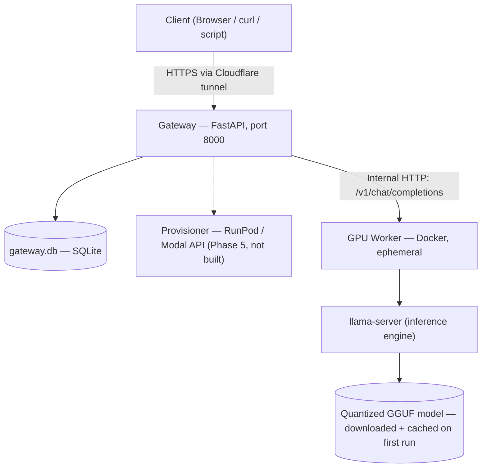

# On-Demand Personal LLM Inference Platform — Build Log & Setup Guide

Personal project: a serverless, on-demand inference API for open-weight LLMs. The pitch: don't
pay for a GPU to sit idle (a rented GPU box billed by the hour costs money even while nobody's
asking it anything), don't pay a commercial API per token, and don't run a GPU 24/7 at home. Spin
GPU compute up only when a request arrives, route it through a stable always-on gateway, and tear
it back down after a period of inactivity — near-zero cost while idle.

This document is meant to be **self-contained**: everything below (architecture, what's been
built, exact commands to reproduce it, and the design for what's not built yet) should be enough
on its own, without needing the original planning conversation. The full original spec also still
lives at [`OnDemand_LLM_Platform_Project_Overview.md`](OnDemand_LLM_Platform_Project_Overview.md)
if you want the original wording, but this README is the up-to-date source of truth — it reflects
what actually happened, including deviations from that original plan (e.g. ngrok → Cloudflare
Tunnel, see §9).

**Scope, by design:** single-user system. No multi-tenancy, no per-user accounts, no
application-level authentication. See §9 for why.

**Hardware context that shapes everything below:** this is being built on a laptop with an
i7-1065G7 CPU, 8 GB RAM, and a 2 GB MX330 GPU. The MX330 is too weak and too low-VRAM to run even
a 4-bit-quantized 7B model — so every phase built so far runs inference on **CPU only**, which is
slow (observed ~1–2 tokens/sec, multi-second-per-token — see §9). Getting onto a *real* GPU
(Kaggle's free T4/P100, then eventually a rented one) is the entire point of Phase 4 onward.

---

## 1. Architecture

### 1.1 Two tiers

**The Gateway (always on, always cheap).** A lightweight FastAPI service meant to run on cheap,
always-available hardware (a $5/month VPS, a free-tier cloud instance, even a spare Raspberry Pi
— currently just this laptop). It is the permanent, stable-URL face of the system. Its job:

- Accept incoming HTTP requests from a browser, script, or app.
- Check whether a GPU worker is currently alive and ready.
- If not, trigger provisioning of one (not built yet — see Phase 5).
- Queue requests while a worker is starting up (not built yet — see Phase 5).
- Forward requests to the worker once ready, and stream responses back.
- Reset an idle timer after each response; tear the worker down when it expires (not built yet
  — see Phase 6).

The gateway never runs the model itself — it's a router, state manager, and (eventually)
lifecycle controller. Because it does no heavy compute, it can run on the cheapest hardware
available.

**The GPU Worker (ephemeral).** A Docker container, launched only when needed, containing:

- The model server — `llama-server` (llama.cpp's built-in HTTP server) for now; vLLM is a
  possible Phase 7 upgrade for production-grade throughput.
- The quantized model weights — **not baked into the image**; downloaded from Hugging Face on
  first run and cached on a mounted volume for subsequent starts.
- A `/health` endpoint the gateway polls to know when the worker is ready.

The worker has no knowledge of sessions, users, or conversation history — all of that lives in
the gateway. Its only job: receive a prompt + context, generate tokens, stream them back.

### 1.2 Component diagram



Dotted line = designed but not implemented yet.

### 1.3 Full request lifecycle (target design — partially built)

This is the intended end-state flow once Phase 5 lands. Today, only steps 1, 6, 7, 8, 9 actually
happen — there's exactly one worker, always running locally, so there's no `IDLE`/`STARTING`
state machine or queueing yet.

1. User sends a prompt to the gateway's `/chat` endpoint.
2. Gateway checks worker status: `IDLE`, `STARTING`, or `READY`. *(not built: today there's only
   ever one worker, assumed always running)*
3. If `IDLE`: gateway calls the provider API to launch a worker, returns `202 Accepted` with a
   job id, status becomes `STARTING`. *(not built)*
4. If `STARTING`: gateway queues the request, holds the connection via SSE or polling. *(not
   built)*
5. Worker comes online (expected 30–90s for a quantized 7B on a real GPU); status becomes
   `READY`. *(not built — no provisioning to wait on yet)*
6. Gateway forwards the prompt + conversation history to the worker. **(built)**
7. Worker runs inference, streams tokens back to the gateway. **(built)**
8. Gateway streams tokens to the client in real time via SSE. **(built)**
9. After the response completes, gateway stores the turn in SQLite. **(built)**
10. Idle timer resets; if no further requests arrive within the timeout, gateway tears the worker
    down. *(not built — see Phase 6)*

The important design point for step 3–4 (when it does get built): the client must always get an
immediate response code, never a connection that just sits there looking frozen. A naive
implementation returns an error when the worker is cold and makes the client retry; the correct
one queues the request transparently so a cold start is just "a longer wait for the first
message," not an error.

### 1.4 Gateway internal modules

| Module | Responsibility | Status |
|---|---|---|
| `storage.py` | Reads/writes conversation history to SQLite | **Built** |
| `main.py` | Routes, request handling, SSE streaming to the client | **Built** |
| `state.py` | Worker state machine: `IDLE → STARTING → READY → IDLE` | Not built (Phase 5) |
| `provisioner.py` | Abstracts the GPU provider API (RunPod/Modal/Vast.ai) — swapping providers means swapping only this module | Not built (Phase 5) |
| `proxy.py` | Currently just inline in `main.py`; would be split out once it needs to handle dynamic worker addresses | Partially built (inline) |
| `queue.py` | Holds requests that arrive while a worker is `STARTING` | Not built (Phase 5) |
| `idle_timer.py` | Background asyncio task that counts down and fires teardown when idle | Not built (Phase 6) |

### 1.5 Worker internal architecture

Intentionally minimal — see §6 for the actual Dockerfiles. Contains: llama.cpp (CPU build for
local dev/testing, CUDA build for Kaggle/RunPod), a startup script that downloads+caches model
weights from Hugging Face on first run, `llama-server` listening on a port, and a `/health`
endpoint returning `200 OK` once the model is loaded.

### 1.6 Cold start handling (design target, Phase 5)

The cold start — delay between a request arriving and the model being ready — is the central UX
problem of this architecture once real provisioning exists. Expected 30–90 seconds on a rented
GPU for a quantized 7B. The planned pattern:

1. Client sends request. Gateway detects worker is `IDLE`.
2. Gateway immediately returns `HTTP 202 Accepted` with a job id + estimated wait.
3. Gateway fires the provisioning API call in the background.
4. Client polls `GET /status/{job_id}` or holds an SSE connection for a `worker_ready` event.
5. Once the worker reports healthy, gateway processes any queued requests.
6. Client gets a `ready` signal and the response streams in normally.

Ways to minimize cold-start time once this exists: use GGUF Q4_K_M quantization (already doing
this — loads in 5–20s on GPU vs. slower for Q8); cache weights on the worker's persistent volume
so only the *first ever* start pays the ~4GB download; keep the Docker image itself small/prebuilt
rather than downloading weights at request time; optionally pre-warm with a no-op keepalive
before the idle timer fires during high-use periods.

**Idle timeout — the cost/latency knob (Phase 6, not yet tunable because nothing bills yet):**
`cost of staying idle an extra N minutes ≈ (N / 60) × GPU_$/hr`. At a typical RunPod rate of
$0.50/hr, staying warm an extra 20 minutes after the last message costs about $0.17.

| Idle timeout | Cold-start frequency | Idle-cost impact | Best for |
|---|---|---|---|
| 2 min | High | Lowest | Infrequent, spread-out questions |
| **10 min (planned default)** | Low-to-moderate | Small | Typical personal chat usage |
| 30+ min | Rare | Noticeable | Only if cold starts are unusually disruptive |

### 1.7 Conversation & context management

LLMs have a finite context window (Mistral 7B: 32K tokens). Three strategies, in increasing
sophistication:

- **Naive (not used):** inject the entire stored history into every prompt. Breaks down after
  ~20 turns — either exceeds the context limit or wastes tokens/latency on signal-free history.
- **Sliding window (what's actually implemented, Phase 3):** keep full history in SQLite forever,
  but only inject the last N turns (N=10 here) into each prompt. Simple, adequate for personal
  use. See §7 for the exact code.
- **Summarization (optional, Phase 6+, not built):** periodically have the LLM summarize older
  turns into a compressed "memory block," stored and injected ahead of recent turns. Preserves
  long-term context at the cost of one extra inference call per summarization pass.

---

## 2. Status at a glance

| Phase | Status | What it is |
|---|---|---|
| 1 | ✅ Done | Local llama.cpp + llama-server, CPU inference |
| 2 | ✅ Done | FastAPI gateway in front of llama-server, exposed via Cloudflare tunnel |
| 3 | ✅ Done | SQLite sliding-window memory + browser chat UI |
| 4 | 🔶 In progress | Docker containerization of the worker (CPU + CUDA Dockerfiles and Kaggle instructions written; **Docker itself is not yet installed on this machine, so nothing has been built/run/verified** — see §6) |
| 5 | ⬜ Not started | Cloud provisioning: `provisioner.py`, `state.py`, `queue.py`, RunPod/Modal integration, the 202+poll cold-start flow — see §8 |
| 6 | ⬜ Not started | `idle_timer.py`, Prometheus/Grafana, gateway hosting on Fly.io/Railway, SQLite→PostgreSQL — see §9 |
| 7 | ⬜ Not started, optional | vLLM upgrade, multi-model routing — see §10 |

---

## 3. Repository layout

```
D:\LLM_Hosting\
├── OnDemand_LLM_Platform_Project_Overview.md   # original spec (historical; README is current)
├── README.md                                    # this file
├── llama.cpp\                                   # Windows CPU build of llama.cpp (Phase 1)
│   └── llama-server.exe, ggml-*.dll, server.log, ...
├── models\
│   └── mistral-7b-instruct-v0.2.Q4_K_M.gguf     # 4.3 GB, downloaded from Hugging Face
├── gateway\                                      # Phase 2-3: the always-on API
│   ├── main.py                                   # FastAPI app: /health, /chat, /conversations
│   ├── storage.py                                # SQLite persistence + sliding window
│   ├── requirements.txt
│   ├── static\index.html                         # dark-themed chat UI, served at "/"
│   ├── gateway.db                                # SQLite conversation history
│   └── venv\                                     # Python virtualenv (not committed anywhere)
└── worker\                                        # Phase 4: containerized worker
    ├── Dockerfile.cpu                             # CPU image — fast local build/test loop
    ├── Dockerfile.cuda                            # CUDA image — for Kaggle/RunPod/Vast.ai
    └── start.sh                                   # shared entrypoint for both images
```

---

## 4. Phase 1 — Local inference (llama.cpp + llama-server) — ✅ Done

**Goal:** run a quantized open-weight model locally and talk to it over HTTP, no gateway yet.

**What's installed:**
- `llama.cpp\` — Windows x64 **CPU** build, release **b11954**
  (`version: 0.7.0-dev (build 11954, commit f1a7dea99)`, confirmed via `llama-server.exe
  --version`), downloaded as a prebuilt zip from the
  [ggml-org/llama.cpp GitHub releases](https://github.com/ggml-org/llama.cpp/releases). No
  compilation needed — llama.cpp cuts a new numbered build (`bNNNNN`) on essentially every merge,
  and the CI publishes prebuilt binaries for each one.
- `models\mistral-7b-instruct-v0.2.Q4_K_M.gguf` — Mistral 7B Instruct v0.2, 4-bit quantized
  (Q4_K_M), ~4.3 GB (4,368,439,584 bytes exactly), downloaded from the
  `TheBloke/Mistral-7B-Instruct-v0.2-GGUF` repo on Hugging Face.

**To reproduce from scratch:**

1. Check the current release build number:
   ```bash
   curl -s https://api.github.com/repos/ggml-org/llama.cpp/releases/tags/<latest-build-tag>
   ```
   (As of this writing llama.cpp's "latest" GitHub release no longer carries prebuilt binaries —
   those live on the separate release tagged with the nightly build number, e.g. `b11960`;
   look for the "**Nightly build:**" link inside the latest versioned release's body, or just
   browse the releases page directly.) Download the asset named
   `llama-b<NNNNN>-bin-win-cpu-x64.zip` and extract it to `D:\LLM_Hosting\llama.cpp\`.
2. Download the GGUF model file into `D:\LLM_Hosting\models\` — either manually from Hugging
   Face, or let `llama-server` fetch it for you on first run (recent builds support `-hf
   <repo>:<quant>` to auto-download and cache — this is exactly what the Phase 4 Docker worker
   does, see §6).
3. Start the server (from inside `llama.cpp\`):
   ```bash
   llama-server.exe -m ../models/mistral-7b-instruct-v0.2.Q4_K_M.gguf --host 127.0.0.1 --port 8080 -c 4096
   ```
   Logs `model loaded` and `listening on http://127.0.0.1:8080` once ready. On this hardware,
   `server.log` shows `n_threads = 4`, `n_ctx_slot = 4096`.
4. Test it:
   ```bash
   curl http://127.0.0.1:8080/health
   curl http://127.0.0.1:8080/v1/chat/completions -H "Content-Type: application/json" -d "{\"messages\":[{\"role\":\"user\",\"content\":\"Say hi in 5 words.\"}]}"
   ```

`llama-server` exposes an OpenAI-compatible `/v1/chat/completions` endpoint and a built-in
`/health` endpoint — both get reused as-is by every later phase, including the Docker worker.

**Verified performance (from `llama.cpp\server.log`, real samples on this hardware):** prompt
eval and generation both run at roughly **1–2 tokens/sec**, e.g. one real request logged `eval
time = 16791.55 ms / 38 tokens (453.83 ms per token, 2.20 tokens per second)` and another `eval
time = 36497.98 ms / 3 tokens (18248.99 ms per token, 0.05 tokens per second)` under load. This
is unusably slow for real use but proves the pipeline works — see the hardware note at the top of
this document.

---

## 5. Phase 2 — Gateway + public tunnel — ✅ Done

**Goal:** wrap `llama-server` behind a stable, proxyable API, and expose it publicly for remote
testing.

**What's built:** `gateway\main.py`, a minimal FastAPI app (dependencies pinned in
`gateway\requirements.txt`: `fastapi==0.162.0`, `uvicorn==0.54.0`, `httpx==0.28.1`,
`pydantic==2.14.1`):

| Route | Method | Purpose |
|---|---|---|
| `/health` | GET | Gateway's own health, plus a passthrough check of the worker's `/health` |
| `/chat` | POST | Accepts `{message, conversation_id?, max_tokens?}`, streams back SSE tokens, stores the turn afterward |
| `/conversations` | POST | Creates a new empty conversation, returns its id |
| `/conversations/{id}` | GET | Returns full stored history for a conversation |
| `/` | GET | Serves `static/index.html` (the chat UI, added in Phase 3) |

Implementation notes (from reading `main.py` directly):
- `WORKER_URL = "http://127.0.0.1:8080"` is **hardcoded** — correct for "exactly one, always-local
  worker" (true through Phase 4); Phase 5 needs to make this dynamic.
- `/chat` streams via `httpx.AsyncClient(timeout=None)` calling the worker's
  `/v1/chat/completions` with `"stream": True`, re-yielding each SSE `data:` line to the client as
  it arrives (no buffering — this is the "streaming across two hops" problem the original spec
  called out as needing careful testing; it works here because FastAPI's `StreamingResponse`
  wraps an async generator that forwards chunks as they're read, not after the whole response is
  collected).
- While streaming, it also accumulates the assistant's full text client-side (from the JSON
  `delta.content` field of each chunk) so it can write one complete `assistant` row to SQLite
  once the stream ends, rather than one row per token.
- Conversation id is returned both in the JSON (for new conversations) and in a response header,
  `X-Conversation-Id`.

**To reproduce from scratch:**

1. Create and activate a virtualenv, then install dependencies:
   ```bash
   cd D:\LLM_Hosting\gateway
   python -m venv venv
   venv\Scripts\activate
   pip install -r requirements.txt
   ```
2. Make sure `llama-server.exe` is already running on port 8080 (Phase 1).
3. Start the gateway:
   ```bash
   uvicorn main:app --host 127.0.0.1 --port 8000
   ```
4. Test locally:
   ```bash
   curl http://127.0.0.1:8000/health
   curl -X POST http://127.0.0.1:8000/chat -H "Content-Type: application/json" -d "{\"message\":\"hi\"}"
   ```

**Exposing it publicly — ngrok → Cloudflare Tunnel, and why:** the original plan called for
ngrok. In practice, **ngrok's Windows client kept getting flagged/quarantined by this machine's
antivirus**, making it unusable without disabling AV protection — not an acceptable trade for a
throwaway dev tunnel. Switched to **Cloudflare's quick tunnel** (`cloudflared`) instead, installed
via:
```bash
winget install --id Cloudflare.cloudflared
```
No AV issues, no account/login needed for a quick tunnel. To expose the running gateway:
```bash
cloudflared tunnel --url http://127.0.0.1:8000
```
This prints a random `https://<something>.trycloudflare.com` URL proxying straight to the
gateway. It's ephemeral (changes every restart of the tunnel) and has no built-in access control
— consistent with the single-user/no-auth design (§9): keep the URL private rather than adding
app-level authentication.

**Verified:** tested end-to-end both via raw `curl` and through the live Cloudflare tunnel URL
from a browser.

---

## 6. Phase 3 — Conversation memory + chat UI — ✅ Done

**Goal:** persistent multi-turn conversations through a browser, without blowing the model's
context window as conversations grow.

**What's built:**

- `gateway\storage.py` — SQLite (`gateway.db`), two tables:
  ```sql
  CREATE TABLE conversations (id INTEGER PRIMARY KEY AUTOINCREMENT, created_at TEXT NOT NULL);
  CREATE TABLE messages (
      id INTEGER PRIMARY KEY AUTOINCREMENT,
      conversation_id INTEGER NOT NULL,
      role TEXT NOT NULL,
      content TEXT NOT NULL,
      created_at TEXT NOT NULL,
      FOREIGN KEY (conversation_id) REFERENCES conversations(id)
  );
  ```
  Created automatically on gateway startup via `storage.init_db()`. Key functions:
  `create_conversation()`, `conversation_exists(id)`, `add_message(id, role, content)`,
  `get_recent_messages(id, limit)` (sliding window, oldest-first), `get_full_history(id)`
  (everything, for the `/conversations/{id}` endpoint).
- **Sliding-window context injection**: `SLIDING_WINDOW_TURNS = 10` in `main.py`. Every message is
  kept forever in SQLite; `get_recent_messages` pulls the last 10 rows ordered by `id DESC` then
  reverses them back to chronological order before they're sent to the model. This is the
  "recommended" strategy from §1.7 — simple, not the full summarization approach (that's Phase
  6+, optional, not built).
- `gateway\static\index.html` — a single-file, dark-themed chat UI served directly by the
  gateway at `/` via `app.mount("/", StaticFiles(directory="static", html=True))`. No build step,
  no separate frontend server.

**To reproduce:** nothing extra to install — this is all inside `gateway\main.py` /
`storage.py`, already covered by the Phase 2 setup. Open `http://127.0.0.1:8000/` (or the
Cloudflare tunnel URL) in a browser and start chatting; `gateway.db` is created next to
`main.py` on first run.

**Verified:** full round trip tested end-to-end (multi-turn conversation through the browser UI,
and via raw `curl`), confirming history persists across gateway restarts and the sliding window
correctly truncates older turns before they reach the model.

---

## 7. Phase 4 — Docker containerization — 🔶 In progress (unverified)

**Goal:** package the worker — llama.cpp + the model — into a reproducible Docker image
containing: llama.cpp built with CUDA support (for real GPU use on Kaggle/RunPod), a startup
script that downloads+caches the GGUF model from Hugging Face on first run (**not** baked into
the image), `llama-server` listening on a port, and a `/health` endpoint the gateway can poll.

**Current status: files are written, but *unbuilt and unverified* on this machine.** Docker
Desktop is not installed here, and installing it requires enabling WSL2 + an admin-elevated
installer — both of which need the user to do manually (deliberately not automated; see §9). As
soon as Docker is available, the verification steps below should be run and this section updated
with real results.

**What's built**, all in `worker\`:

- **`start.sh`** — shared entrypoint for both images. Translates environment variables
  (`MODEL_REPO`, `MODEL_QUANT`, `CTX_SIZE`, `N_GPU_LAYERS`, `HOST`, `PORT`) into a `llama-server`
  invocation:
  ```bash
  exec llama-server -hf "${MODEL_REPO}:${MODEL_QUANT}" --host "${HOST}" --port "${PORT}" \
      --ctx-size "${CTX_SIZE}" --n-gpu-layers "${N_GPU_LAYERS}"
  ```
  Deliberately thin: it does **not** hand-roll a Hugging Face downloader. Recent `llama-server`
  builds support `-hf <repo>:<quant>` natively — it resolves the quant tag against the repo's
  file list, downloads the matching GGUF, and caches it under the directory named by the
  `LLAMA_CACHE` environment variable (confirmed by reading llama.cpp's `common/common.cpp`:
  `fs_get_cache_directory()` checks `LLAMA_CACHE` first and uses it verbatim if set; defaults to
  `~/.cache/llama.cpp` otherwise). Both Dockerfiles set `LLAMA_CACHE=/models`, mounted as a Docker
  volume so the ~4.3 GB download survives container restarts and is never baked into the image.
- **`Dockerfile.cpu`** — `ubuntu:24.04` base, downloads the prebuilt Linux CPU release of
  llama.cpp directly from GitHub releases, currently pinned to build **b11960** via the
  `LLAMA_RELEASE` build arg (asset `llama-b11960-bin-ubuntu-x64.tar.gz`, confirmed to exist and
  extract to a flat `llama-b11960/` directory containing `llama-server` plus all its shared
  libs — actually downloaded and inspected during this session, not guessed). Note this is a few
  builds ahead of the Windows build used locally in Phase 1 (b11954) — llama.cpp cuts new builds
  on nearly every merge, exact parity isn't the goal, just "recent enough." Runtime apt packages
  installed: `ca-certificates`, `curl` (healthcheck + the HF download itself), `libgomp1`
  (OpenMP, required by the ggml CPU backend — confirmed via binary inspection:
  `libggml-cpu-*.so` link against `libgomp.so.1`), `libssl3` (the server binary links against
  `libssl.so.3`/`libcrypto.so.3`), `libstdc++6`, `libgcc-s1`. The CPU backend ships multiple SIMD
  variants (`libggml-cpu-haswell.so`, `-icelake`, `-skylakex`, `-zen4`, etc.) and auto-selects the
  right one for whatever CPU the container runs on via runtime CPUID detection — no manual
  selection needed.
- **`Dockerfile.cuda`** — same pattern, but pulls the CUDA 12.8 build of llama.cpp
  (`llama-b11960-bin-ubuntu-cuda-12.8-x64.tar.gz`) plus its matching **`cudart-llama-b11960-bin-
  ubuntu-cuda-12.8-x64.tar.gz`** asset — a redistributable bundle of just the CUDA runtime `.so`
  files llama.cpp needs (`libcudart.so.12`, `libcublasLt.so.12`, etc. — confirmed by partially
  downloading and listing that tarball's contents during this session). Built on plain
  `ubuntu:24.04` rather than the full `nvidia/cuda` base image, so the image stays smaller; the
  **host** still needs an NVIDIA driver + the NVIDIA Container Toolkit (`docker run --gpus all
  ...`), which RunPod/Vast.ai GPU templates provide out of the box. Both tarballs extract (with
  `--strip-components=1`) into the same `/opt/llama.cpp/bin` directory so `LD_LIBRARY_PATH` picks
  up both llama.cpp's own libs and the CUDA runtime libs from one place. Defaults to
  `N_GPU_LAYERS=999` (offload every layer) and `CTX_SIZE=8192`, since a real GPU can afford both.

Both Dockerfiles declare a `VOLUME ["/models"]`, `EXPOSE 8080`, and a `HEALTHCHECK` that curls
`http://localhost:${PORT}/health` — llama-server's built-in health endpoint, confirmed (via its
server README) to return HTTP 503 `{"error": {...}}` while loading and HTTP 200 `{"status":
"ok"}` once ready, which is exactly the shape Docker's `HEALTHCHECK` and the gateway's polling
loop both want.

**How to verify the CPU image (once Docker is installed):**

```bash
cd D:\LLM_Hosting\worker
docker build -f Dockerfile.cpu -t llm-worker:cpu .
docker run --rm -p 8080:8080 -v llm_models:/models llm-worker:cpu
# in another terminal, once it logs "model loaded":
curl http://localhost:8080/health
curl http://localhost:8080/v1/chat/completions -H "Content-Type: application/json" -d "{\"messages\":[{\"role\":\"user\",\"content\":\"Say hi in 5 words.\"}]}"
```

First run downloads the ~4.3 GB model into the `llm_models` named volume (slow on CPU + this
connection); subsequent `docker run`s reuse the cached volume and skip straight to loading.

**How to build (but not run/verify) the CUDA image** — this only needs Docker itself, not a local
GPU, to confirm it builds:

```bash
docker build -f Dockerfile.cuda -t llm-worker:cuda .
```

Actually *running* it needs a real NVIDIA GPU + the container toolkit — i.e. Kaggle or a rented
GPU box, covered next.

**Running the worker on Kaggle's free GPU notebooks — important correction to the original
plan:** Kaggle's free GPU notebooks (T4/P100) do **not** give you a Docker daemon — you can't
`docker build` or `docker run` *inside* a Kaggle notebook; the notebook itself already *is* a
container, and Kaggle doesn't expose nested/privileged Docker. So "running the Docker image on
Kaggle" really means: **run the equivalent commands directly in notebook cells**, using the same
llama.cpp CUDA release asset and the same `start.sh` logic the Dockerfile encodes — just not
through `docker run`. Concretely, in a Kaggle notebook with the GPU accelerator turned on:

```bash
%%bash
curl -fsSL -o llama.tar.gz https://github.com/ggml-org/llama.cpp/releases/download/b11960/llama-b11960-bin-ubuntu-cuda-12.8-x64.tar.gz
curl -fsSL -o cudart.tar.gz https://github.com/ggml-org/llama.cpp/releases/download/b11960/cudart-llama-b11960-bin-ubuntu-cuda-12.8-x64.tar.gz
mkdir -p llama/bin
tar -xzf llama.tar.gz -C llama/bin --strip-components=1
tar -xzf cudart.tar.gz -C llama/bin --strip-components=1
export LD_LIBRARY_PATH=/kaggle/working/llama/bin
export LLAMA_CACHE=/kaggle/working/models
nohup ./llama/bin/llama-server -hf TheBloke/Mistral-7B-Instruct-v0.2-GGUF:Q4_K_M \
    --host 0.0.0.0 --port 8080 --ctx-size 8192 --n-gpu-layers 999 > server.log 2>&1 &
sleep 5 && curl http://localhost:8080/health
```

Kaggle notebooks also don't expose inbound ports to the public internet, so reaching this from
the gateway additionally needs a tunnel started *from inside the notebook* (e.g. `cloudflared`
again, or `ngrok` if its Kaggle Linux client doesn't trip the same AV issue the Windows one did
locally) pointed at `localhost:8080`. That wiring is Phase 5 territory (provisioner + dynamic
worker URL) and hasn't been built yet — Phase 4's job is just proving the GPU container/command
set boots and serves inference correctly, which this recipe does.

**Still to do before Phase 4 is actually "done":** install Docker locally, run the verification
commands above for the CPU image, build (and ideally run, if a GPU is reachable) the CUDA image,
and manually try the Kaggle recipe in a live Kaggle notebook.

---

## 8. Phase 5 (planned, not started) — Cloud provisioning

**Goal:** migrate the worker from "always running locally/manually on Kaggle" to automatically
provisioned on a real cloud GPU provider, with the gateway able to spin one up on demand, wait
for it, and know its address.

**What needs to get built:**

- **`provisioner.py`** — abstracts the GPU provider's REST API (RunPod Serverless or Modal are
  the leading candidates; Vast.ai is a fallback option). Picking RunPod Serverless or Modal over
  rolling a custom VM-based solution matters because both expose a REST API for programmatic
  start/stop with **$0 idle cost** billing models — exactly what this project needs. Swapping
  providers later should mean swapping only this module.
- **`state.py`** — an in-memory + DB-backed state machine for the worker: `IDLE → STARTING →
  READY → IDLE`. The gateway's `/chat` handler needs to branch on this instead of always assuming
  a worker is reachable at `127.0.0.1:8080`.
- **`queue.py`** — holds requests that arrive while the worker is `STARTING`, releases them once
  it's `READY`. Needed because a provisioning call plus a 30–90s model load is far too slow to
  make a client wait on an open connection without an explicit "this is normal, hang on" signal.
- The cold-start response flow described in §1.6 (`202 Accepted` + job id, then poll `/status/
  {job_id}` or an SSE `worker_ready` event).
- **Dynamic worker URLs.** Each provisioned worker gets a different IP/port; the gateway must
  query the provider API after launch to get the real endpoint, then talk to that instead of the
  current hardcoded `WORKER_URL`. The client only ever talks to the gateway's stable URL — never
  needs to know the worker's actual address. This is the core reason the gateway/worker split
  exists at all.
- **Worker health polling with backoff.** After launching, poll `/health` with increasing
  intervals (1s, 2s, 4s, ...) and a hard max wait (e.g. 5 minutes), after which the worker is
  declared failed and provisioning is retried rather than hanging forever.
- **Provider API failure handling.** RunPod/Modal calls can fail; worker containers can crash
  mid-inference. The gateway needs to detect this (timeouts, health-check failures, provider
  webhooks) and transparently reprovision — in-flight requests may fail and should return a
  retryable `503`, but stored conversation history must never be lost.

**Why this hasn't started yet:** it depends on Phase 4's Docker image actually being verified
working (no point wiring up a provisioner to launch a container that's never been run), and on
picking + signing up for an actual GPU provider account, which is a real-money decision the user
needs to make deliberately rather than something to default into.

**Difficulty:** High (per the original roadmap) — this is the most architecturally involved
remaining phase.

---

## 9. Phase 6 (planned, not started) — Idle shutdown + observability

**Goal:** make the on-demand cost story real (actually tearing down idle GPU workers) and make
the system's behavior visible/measurable.

**What needs to get built:**

- **`idle_timer.py`** — a background asyncio task that resets on every request and, after the
  configured idle timeout (10 minutes is the recommended default — see the cost table in §1.6)
  with no further requests, calls the provisioner to tear the worker down.
- **Prometheus metrics export from FastAPI**, plus **Grafana dashboards** for: cold-start time,
  GPU cost per request, idle time. This is what makes the idle-timeout tradeoff in §1.6 something
  you can actually tune from real data instead of guessing.
- **Gateway hosting on Fly.io or Railway** — both support Docker deployment and auto-restart on
  failure, either is a reasonable free-tier home for the always-on gateway once it's not just
  running on this laptop.
- **SQLite → PostgreSQL migration**, using the same SQLAlchemy ORM code so this is a config
  change rather than a rewrite. Needed once there's concurrent write pressure or the gateway needs
  to be reachable from a database outside its own filesystem (e.g. once it's hosted remotely
  rather than running next to `gateway.db` on this laptop).

**Success metrics to evaluate once this phase is done** (from the original spec, worth tracking
from here on regardless of exact numbers):

| Metric | Target |
|---|---|
| Cold-start time (P95) | < 90 seconds |
| First token latency (warm) | < 3 seconds |
| Idle GPU cost | $0.00/hr while idle |
| Total monthly GPU spend | < $5–10/month (set your own budget) |
| Cost per inference request | Meaningfully lower than the commercial-API equivalent |
| API uptime (gateway) | > 99% over 30 days |
| Context injection accuracy | Last N turns always present in prompt |
| Conversation persistence | Zero lost turns across restarts |

**Difficulty:** High.

---

## 10. Phase 7 (optional, planned, not started) — vLLM + multi-model routing

**Goal:** graduate from llama.cpp to a production-grade inference engine, and support more than
one model size.

- **Replace llama.cpp with vLLM** for the worker's inference engine — continuous batching,
  significantly higher throughput than llama.cpp, but requires a CUDA GPU with enough VRAM (no
  CPU fallback the way llama.cpp has one, which is why llama.cpp stayed the right choice through
  Phase 1–6: it's the only option that works on this laptop's CPU for local dev).
- **Multi-model routing** — route quick questions to a small/fast model, reasoning-heavy requests
  to a larger one, instead of one fixed model for everything.

This phase is explicitly optional and listed last for a reason: everything through Phase 6
already delivers the core "on-demand, near-zero-idle-cost personal inference platform" goal.
vLLM and multi-model routing are throughput/quality upgrades on top of a working system, not
prerequisites for it.

**Difficulty:** High.

---

## 11. Key decisions & gotchas

- **No application-level authentication, by design.** Single-user system — adding login/API keys
  would be pure overhead for a project with exactly one user. The real risk is the gateway's
  public URL leaking and someone else triggering GPU spend; mitigated at the network level (keep
  the Cloudflare tunnel URL private, don't publish it, watch the cost metrics in §9 once they
  exist) rather than in the app.
- **CPU-only locally, by necessity, not choice.** See the hardware note at the top of this
  document and the verified throughput numbers in §4 — this is the entire motivation for Phase 4
  (Docker) and Phase 5 (cloud GPU provisioning): the same worker image needs to run identically
  here (for fast iteration) and on an actual GPU (for usable speed).
- **ngrok → Cloudflare Tunnel.** Planned tool was ngrok; swapped to `cloudflared` because ngrok's
  Windows client was repeatedly flagged/quarantined by this machine's antivirus. Cloudflare's
  quick tunnel needs no install-time AV exceptions and no account for ad-hoc use. If a Kaggle
  notebook ever needs a tunnel (Phase 4/5), re-check whether ngrok's Linux client has the same
  problem before assuming it's fine there just because it failed on Windows.
- **Docker installs require admin elevation — deliberately not automated.** Installing Docker
  Desktop (and the WSL2 it depends on for the Windows backend) needs an admin-elevated installer
  and likely a reboot. Flagged back to the user rather than attempted automatically — this is a
  system-level, hard-to-reverse action that isn't appropriate to just do unasked.
- **Kaggle is not "Docker in the cloud."** Easy to assume you can just `docker run` your worker
  image on a Kaggle GPU notebook — you can't; there's no Docker daemon inside a Kaggle kernel
  (see §7). The Dockerfiles are still useful: they're the source of truth for exactly which
  llama.cpp release + flags + libraries are needed, and they're what RunPod/Vast.ai will actually
  run in Phase 5. Kaggle itself runs the equivalent shell commands directly, not the image.
- **`llama-server`'s built-in `-hf` flag replaces a hand-written downloader.** The original design
  called for "a startup script that downloads+caches the GGUF model from Hugging Face on first
  run" — recent llama.cpp builds do this natively, so `worker\start.sh` just configures and calls
  it rather than reimplementing HF API calls. Verified by reading llama.cpp's own server docs and
  `common/common.cpp` source directly (see §7) rather than assumed.
- **Gateway's worker address is still hardcoded.** `WORKER_URL = "http://127.0.0.1:8080"` in
  `main.py` is correct for "one local worker" (Phases 1–4) and becomes the first thing Phase 5
  needs to change.
- **Streaming across two hops works, but was the trickiest part of Phase 2 to get right.**
  Buffering anywhere in the client → gateway → worker chain breaks the real-time feel. FastAPI's
  `StreamingResponse` over an async generator that forwards each `httpx` streamed chunk as it
  arrives (rather than collecting the full response first) is what makes this work — see the
  implementation notes in §5.

---

## 12. Deliberately deferred (and why)

Scope decisions, not oversights:

- **Kubernetes** — not applicable at this scale; worth learning after this project if pursuing
  platform engineering generally, not needed here.
- **Celery / distributed task queues** — asyncio handles single-worker request queuing (Phase 5)
  adequately; there's only ever one worker to coordinate.
- **Terraform / infrastructure-as-code** — worthwhile eventually, but manual provisioning is fine
  for a personal project with one deployment target.
- **Google Colab as a GPU option** — considered and rejected: Colab can't expose inbound
  connections (no public IP, no open ports), can't be provisioned via API, and sessions die after
  90 minutes idle. Kaggle is used for GPU testing instead (free, longer sessions, no inbound-port
  requirement since the gateway reaches it via an outbound tunnel); RunPod/Modal are for the
  programmatic provisioning Colab can't do.
